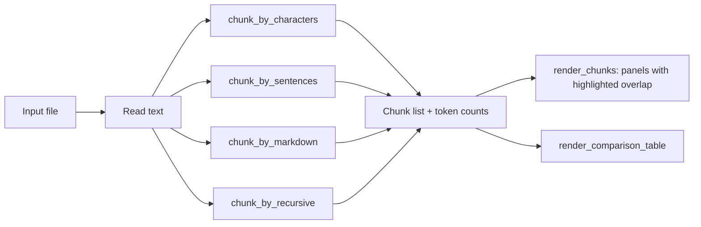

# rag-chunk-visualizer

A small CLI that splits a `.md`, `.py` or `.txt` file with four chunking strategies and shows exactly where each chunk starts, ends and overlaps.

Retrieval quality depends on what ends up inside each chunk: a split in the middle of a sentence, a function, or a section heading produces embeddings that match poorly and return half an answer. Looking at the boundaries and the overlap cost before you embed a corpus lets you pick a strategy and size on evidence instead of guessing, and avoids paying to re-embed everything later.

For the full background (what it does, why, how each strategy works, and where it fits), see [about.md](about.md).

## What it shows

- One panel per chunk, with the text carried over from the previous chunk highlighted in yellow.
- A comparison table across strategies: chunk count, average / min / max tokens, total tokens, and overlap overhead as a percentage of the source file's tokens.

Tokens are counted with `tiktoken` using the `o200k_base` encoding.

## Strategies

| Name | How it splits | Overlap |
|------|---------------|---------|
| `character` | Fixed-size sliding window of `--size` characters | Last `--overlap` characters of the previous chunk |
| `sentence` | Groups sentences (split on `.`, `!`, `?`) up to `--size` characters | Last sentence of the previous chunk |
| `markdown` | Splits on Markdown headers or top-level `def` / `class` lines, then on blank lines if a block is longer than `--size` | None |
| `recursive` | Splits hierarchically by paragraph (`\n\n`), line (`\n`), word (` `), and characters up to `--size` | Carried over from the previous chunk up to `--overlap` characters |


## Setup

Requires Python 3.11+.

```bash
git clone <your-fork-url> rag-chunk-visualizer
cd rag-chunk-visualizer
python -m venv .venv
```

Activate the virtual environment:

```bash
# Linux / macOS
source .venv/bin/activate

# Windows (PowerShell)
.venv\Scripts\Activate.ps1

# Windows (cmd)
.venv\Scripts\activate.bat
```

Install the project in editable mode:

```bash
pip install -e .
```

This installs `rich`, `tiktoken` and `typer`, and adds the `chunk-viz` command to the environment.

`tiktoken` downloads the `o200k_base` encoding file the first time it runs and caches it. After that the tool works offline.

## Running the project

With the virtual environment active, point the tool at any `.md`, `.py` or `.txt` file:

```bash
chunk-viz --path README.md
```

If the `chunk-viz` command is not on your PATH, run the module directly from the project root:

```bash
python -m src.cli --path README.md
```

If you see `ModuleNotFoundError: No module named 'tiktoken'` (or `rich` / `typer`), the dependencies are not installed in the Python you are using. This usually means the virtual environment is not active, for example when a conda `(base)` prompt is in use. Activate `.venv` as shown in Setup, or run `pip install -e .` in the current environment.

Print the built-in help:

```bash
chunk-viz --help
```

## Using it

### Options

| Flag | Default | Description |
|------|---------|-------------|
| `--path`, `-f` | required | Input file |
| `--strategy`, `-s` | `all` | `character`, `sentence`, `markdown`, `recursive` or `all` |
| `--size` | `300` | Target max characters per chunk (used by all strategies) |
| `--overlap` | `50` | Character overlap for `character` and `recursive` strategies, must be smaller than `--size` |
| `--limit` | `5` | Max chunk panels printed per strategy (`0` prints only the table) |

### Examples

Compare all four strategies on a file:

```bash
chunk-viz -f docs/guide.md
```

Look at the recursive strategy with custom chunk size:

```bash
chunk-viz -f notes.txt -s recursive --size 500 --overlap 100
```

Look at one strategy with larger chunks and show more panels:

```bash
chunk-viz -f notes.txt -s sentence --size 500 --limit 10
```

Tune the character window overlap:

```bash
chunk-viz -f src/chunkers.py -s character --size 400 --overlap 80
```

Show only the comparison table:

```bash
chunk-viz -f docs/guide.md --limit 0
```

### Reading the output

Each strategy prints a header line with its chunk count, followed by up to `--limit` panels:

```
┌───────────────────────── chunk 1 ─────────────────────────┐
│ ...last 50 chars of chunk 0... rest of chunk 1 text        │
└──────── tokens: 74 | chars: 300 | overlap_chars: 50 ───────┘
```

- **Highlighted text:** the text at the start of a panel, shown in black on yellow, was repeated from the previous chunk.
- **Panel subtitle:** shows the chunk's token count, character count and overlap length.
- **Comparison table:** comes last. If Total Tokens is much higher than the source file's token count (shown in the caption), you are paying to embed a lot of duplicated text. If Min/Max Tokens is very uneven, some chunks may be too small to be useful or too large for your embedding model.

A practical loop: run with `--strategy all`, pick the strategy with sensible boundaries, then adjust `--size` (and `--overlap` for `character` and `recursive`) until the overhead and token range look right for your embedding model.

## Pipeline



## Development

```bash
pip install pytest ruff
ruff check .
python -m pytest
```
