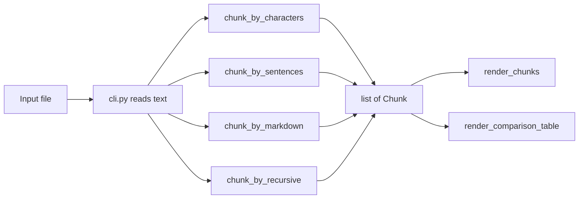

# About rag-chunk-visualizer

## What

`rag-chunk-visualizer` is a command-line tool that takes one text file (`.md`, `.py` or `.txt`), splits it with three chunking strategies, and prints the result in the terminal:

- **Chunk panels:** each chunk in its own bordered panel, with the colour changing between chunks. Text carried over from the previous chunk is highlighted in black on yellow, so you can see exactly where chunks overlap.
- **Comparison table:** the strategies side by side, showing chunk count, average / min / max tokens per chunk, total tokens, and how much extra text the overlap adds.

It does not embed anything, call an API, or write files. It only reads the input file and prints to the terminal.

## Why

In a RAG (retrieval-augmented generation) pipeline, documents are cut into chunks, each chunk is embedded, and the vectors go into a vector database. At query time the database returns whole chunks, so the chunk boundaries decide what the model gets to read. Common problems:

- **Bad splits:** a chunk ends mid-sentence or mid-function, so the retrieved text is incomplete and its embedding matches the question poorly.
- **Sections that run together:** a heading is separated from its body, or two unrelated sections share one chunk.
- **Overlap cost:** overlap helps keep context across boundaries, but every overlapping character is embedded and stored twice. On a large corpus that adds real cost, which you usually can't see.
- **Context-window limits:** chunks that run over the embedding model's or LLM's token limit get truncated without warning.

Re-embedding a corpus because the chunking was wrong is slow and costs money. This tool lets you check boundaries and token numbers on a sample file first, and pick a strategy and chunk size based on what you see.

## How

### Strategies

All strategies are plain Python without external RAG orchestration frameworks.

**character** (`chunk_by_characters`)
A sliding window of `chunk_size` characters that moves forward `chunk_size - overlap` characters each step. Each chunk after the first starts with the last `overlap` characters of the previous chunk, and that carried-over text is stored in `overlap_prefix`. It is simple and predictable, but ignores words, sentences and structure.

**sentence** (`chunk_by_sentences`)
Splits the text into sentences with `(?<=[.!?])\s+`, then adds sentences to a chunk until the next one would go over `max_chars`. The last `overlap_sentences` sentences (default 1) are repeated at the start of the next chunk. It never cuts a sentence in half. Text with few sentence endings, like Markdown lists or code, can produce very long "sentences".

**markdown** (`chunk_by_markdown`)
Splits before every Markdown header (`#` to `######`) and every top-level `def ` or `class ` line, so it works for both `.md` and `.py` files. A block longer than `max_chars` is split again at blank lines (`\n\n`), and the paragraphs are grouped back together up to `max_chars`. There is no overlap. Known limits: a line inside a fenced code block that looks like a heading or a `def` is also a split point, and a single paragraph longer than `max_chars` stays whole.

**recursive** (`chunk_by_recursive`)
The industry standard RAG splitting pattern. Attempts to split hierarchically along semantic boundaries in order of priority: paragraphs (`\n\n`), single lines (`\n`), whitespace words (` `), and characters (`""`). Each chunk respects `chunk_size` and carries over trailing context up to `overlap` characters while preserving semantic units wherever possible.

### Data model

Every strategy returns a list of `Chunk`:

| Field | Meaning |
|-------|---------|
| `index` | Position of the chunk, starting at 0 |
| `text` | Full chunk text, including the overlap at the start |
| `overlap_prefix` | The leading part of `text` repeated from the previous chunk (empty if none) |
| `token_count` | Tokens in `text` |
| `char_count` | Characters in `text` |

### Metrics

Tokens are counted with `tiktoken` using the `o200k_base` encoding (the one used by GPT-4o-class models). It is a reasonable stand-in for most current embedding tokenizers.

| Column | How it is computed |
|--------|--------------------|
| Chunks | Number of chunks |
| Avg Tokens | Mean of `token_count` |
| Min/Max Tokens | Smallest and largest `token_count` |
| Total Tokens | Sum of `token_count`, which is what you would pay to embed |
| Overlap Overhead % | Tokens in all `overlap_prefix` values, divided by the tokens in the original file |

The table caption shows the token count of the original file. When Total Tokens is well above that number, the extra comes from overlap.

### Flow



## Where

### Where it fits

Use it before the embedding step of a RAG pipeline, while you are choosing a chunking strategy and size. It works locally on a laptop or in CI. The only network access is tiktoken's one-time download of the encoding file.

### Where the code lives

```
rag-chunk-visualizer/
├── .github/workflows/ci.yml   ruff + pytest on push and pull request (Python 3.11)
├── src/
│   ├── __init__.py            package version
│   ├── chunkers.py            Chunk dataclass, count_tokens, the three chunkers
│   ├── visualizer.py          rich panels and comparison table
│   └── cli.py                 typer entrypoint (chunk-viz)
├── tests/test.py              unit tests for tokens and each chunker
├── pyproject.toml             dependencies, entrypoint, ruff and pytest config
├── about.md                   this file
└── README.md                  setup and usage
```

### Dependencies

- `rich`: terminal panels, colours and tables
- `tiktoken`: token counting
- `typer`: command-line parsing

Requires Python 3.11 or newer.
